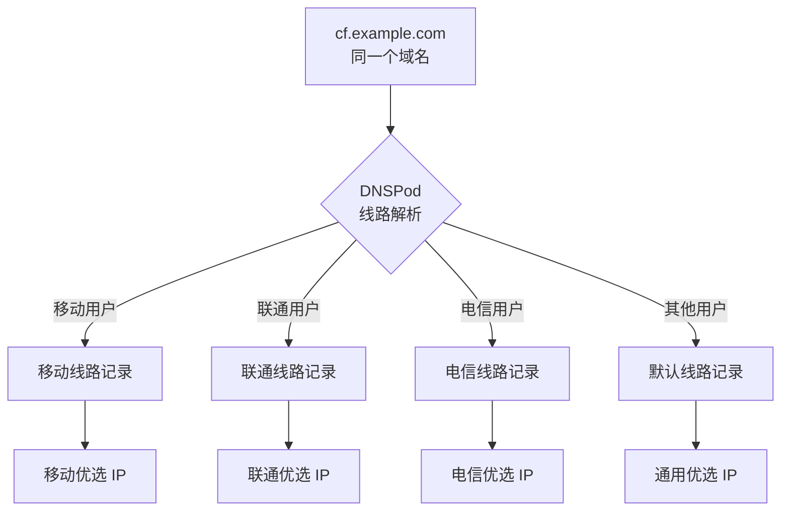

# cf-ddns

> 按运营商线路优选 Cloudflare 节点 + 智能 DNS 更新 · 纯 Go 标准库 · 零依赖 · 单文件二进制


## 简介

cf-ddns 是「按运营商线路优选 Cloudflare 节点 + 智能 DNS 更新」工具：纯 Go 标准库实现，零依赖，编译后是单文件二进制，开箱即用。

Cloudflare anycast IP 在国内不同运营商下的质量差异很大——对移动最快的 IP，对电信可能很慢。常见做法是定期测速、更换 IP，但一条 DNS 记录只能有一个值。cf-ddns 为每条运营商线路（默认 / 移动 / 联通 / 电信）分别优选节点，再借助 DNSPod 的线路解析能力，把同一个域名写成不同线路的解析记录：移动 / 联通 / 电信用户访问同一个域名，各自解析到自己线路最快的节点。

## 工作原理



## 特性

- 纯 Go 标准库实现，零第三方依赖，单文件二进制
- 按运营商线路（默认 / 移动 / 联通 / 电信）分别优选节点
- 自动识别候选类型：IPv4 → A、IPv6 → AAAA、域名 → CNAME
- 并发测速（默认 50 协程），同一轮内共享缓存，重复地址只测一次
- 幂等收敛：无则创建、一致则跳过、不同则更新，不做破坏性删除
- 支持 DNSPod 分线路解析与 Cloudflare 单记录兼容模式
- 跨平台（Linux / Windows / macOS），Go 1.26+

## 核心工作流

每轮循环对所有线路执行以下 6 步；所有线路处理完毕后休眠 `interval`（默认 10 分钟）再开始下一轮，单条线路失败不影响其它线路。

1. **拉取候选** — 对每条线路从 BestCF 获取该运营商对应的优选列表（`IP#备注` 格式，每行一个；可带端口；IPv6 用方括号）。
2. **类型识别** — 自动判断每行：IPv4 → A 记录、IPv6 → AAAA 记录（需开启 `ipv6`）、域名 → CNAME 记录；去重并忽略无法识别的条目。
3. **并发测速** — `task`（默认 50 协程）并发：TCP:80 建连 + HTTP GET，确认存活并从 CF-RAY 响应头提取数据中心代码（如 `HKG`）；同一轮内多条线路共享测速缓存，重复地址只测一次；建连超时 1s、探测上限 2s。
4. **分槽位选优** — 主槽位由 IPv4 / 域名候选竞争一条 A 或 CNAME 记录（二者互斥），v6 槽位由 IPv6 候选竞争一条 AAAA 记录；可先按 `colo` 数据中心过滤。
5. **收敛记录** — 与线上现有记录比对：无记录则创建、一致则跳过（幂等）、不同则更新；CNAME 与 AAAA 互斥（CNAME 目标域名自带双栈解析，主记录为 CNAME 时跳过 AAAA 维护）；若线路上残留冲突 AAAA 记录则提示手动清理，不做破坏性删除。
6. **循环** — 所有线路处理完毕后休眠 `interval`（默认 `10m`）重复上述流程；单条线路失败不影响其它线路。

## 选优策略

| 策略 | 选择方式 | 适用场景 |
| --- | --- | --- |
| `order`（默认） | 本机测速仅用于存活过滤，在存活候选中取 BestCF 列表排名最靠前的 | 跨运营商线路：程序跑在电信机器上时，实测的移动线路延迟没有参考价值，应信任 BestCF 的全国多点测速排名 |
| `latency` | 取本机实测建连延迟最低的候选 | 程序部署在与该线路相同运营商的网络中，本机测速结果可信 |

## 快速开始

### 1. 准备域名：托管到 DNSPod

Cloudflare DNS 没有运营商线路维度，承载优选记录的域名需托管到 DNSPod（免费套餐即可）。两种方案任选其一：

- **方案 A · 整域托管**：把域名的 NS 记录改为 DNSPod 提供的 `f1g1ns1.dnspod.net`，整域迁入 DNSPod。
- **方案 B · 子域名委派**：域名保留在 Cloudflare，为承载优选记录的子域名（如 `cf.example.com`）添加 NS 记录，指向 DNSPod。

验证：

```bash
nslookup -type=NS 你的域名   # 应返回 DNSPod 的 NS 记录
```

### 2. 获取腾讯云密钥

腾讯云控制台 → 访问管理 → API 密钥管理，创建密钥。建议使用子账号并仅授权 `QcloudDNSPodFullAccess`，避免主账号密钥泄露造成过大影响。

### 3. 写配置

```bash
cp config.example.json config.json
```

> **注意**：配置文件必须为 UTF-8 编码——线路名是中文，切勿用 GBK / ANSI 保存。

### 4. 构建并试运行

```bash
go build -o cf-ddns .
./cf-ddns -config config.json -dry-run   # 仅测速，不写 DNS
./cf-ddns -config config.json            # 正式运行
```

## 配置参考

### JSON 示例（dnspod 分线路模式）

```json
{
  "provider": "dnspod",
  "record": "cf.example.com",
  "ttl": 600,
  "interval": "10m",
  "task": 50,
  "colo": "HKG,NRT",
  "ipv6": true,
  "dry_run": false,
  "secret_id": "AKID…",
  "secret_key": "…",
  "domain": "example.com",
  "lines": [
    { "line": "默认", "ips_url": "https://github.com/DustinWin/BestCF/releases/download/bestcf/bestcf-ip.txt", "pick": "order" },
    { "line": "移动", "ips_url": "https://github.com/DustinWin/BestCF/releases/download/bestcf/cmcc-ip.txt", "pick": "order", "colo": "HKG,NRT" },
    { "line": "联通", "ips_url": "https://github.com/DustinWin/BestCF/releases/download/bestcf/cucc-ip.txt", "pick": "latency" },
    { "line": "电信", "ips_url": "https://github.com/DustinWin/BestCF/releases/download/bestcf/ctcc-ip.txt", "pick": "order" }
  ]
}
```

### 通用字段

| 字段 | 类型 | 默认 | 说明 |
| --- | --- | --- | --- |
| `provider` | string | `cloudflare` | `dnspod`：分线路模式；`cloudflare`：单记录兼容模式 |
| `record` | string | — | 完整记录名，如 `cf.example.com` |
| `ttl` | int | dnspod 600 / cloudflare 60 | DNS TTL |
| `interval` | string | `"10m"` | Go duration 格式，一轮循环的休眠时长 |
| `task` | int | `50` | 并发测速协程数 |
| `colo` | string | 空 | 全局数据中心过滤，逗号分隔（如 `HKG,NRT`） |
| `ipv6` | bool | `false` | 是否优选 IPv6 并维护 AAAA 记录；需本机具备 IPv6 连通 |
| `dry_run` | bool | `false` | 仅测速并输出结果，不写 DNS |

### lines 元素

| 字段 | 类型 | 默认 | 说明 |
| --- | --- | --- | --- |
| `line` | string | 必填 | 线路名：`默认` / `移动` / `联通` / `电信`，须与 DNSPod 一致 |
| `ips_url` | string | 必填 | 候选列表地址（BestCF 下载） |
| `pick` | string | `order` | `order`（信任 BestCF 排名）或 `latency`（本机实测最低） |
| `colo` | string | 继承全局 | 线路级数据中心过滤，缺省继承全局 `colo` |

### 服务商专属

| provider | 字段 | 类型 | 说明 |
| --- | --- | --- | --- |
| `dnspod` | `secret_id` / `secret_key` / `domain` | string | 腾讯云 API 密钥与域名（如 `example.com`） |
| `cloudflare` | `cf_token` / `zone_id` | string | API Token（需 Zone→DNS→Edit 权限）与 Zone ID（域名 Overview 页右下角） |
| `cloudflare` | `proxied` | bool | 是否开启代理（小黄云）；直连优选场景应为 `false` |

### 候选列表地址

| 线路 | 文件名 |
| --- | --- |
| 默认 / 通用 | `bestcf-ip.txt` |
| 移动 | `cmcc-ip.txt` |
| 联通 | `cucc-ip.txt` |
| 电信 | `ctcc-ip.txt` |
| 优选域名（CNAME） | `bestcf-domain.txt` |

完整地址形如：

```
https://github.com/DustinWin/BestCF/releases/download/bestcf/<文件名>
```

## 命令行参数

| 参数 | 说明 |
| --- | --- |
| `-config` | 配置文件路径 |
| `-cf-token` | Cloudflare API Token |
| `-zone-id` | Cloudflare Zone ID |
| `-record` | 完整记录名 |
| `-proxied` | 是否开启代理（小黄云） |
| `-ttl` | TTL |
| `-interval` | 循环间隔（Go duration，如 `"10m"`） |
| `-ips-url` | 候选列表地址 |
| `-colo` | 数据中心过滤（逗号分隔） |
| `-task` | 并发测速协程数 |
| `-ipv6` | 启用 IPv6 优选 |
| `-dry-run` | 仅测速，不写 DNS |

`-dry-run` 与 `-ipv6` 在显式传入时会覆盖配置文件中的对应值。

## 部署（systemd）

### 交叉编译与传输

```bash
GOOS=linux GOARCH=amd64 go build -o cf-ddns .
scp cf-ddns config.json user@server:/tmp/   # 含密钥，务必走加密通道
sudo install -m 0755 /tmp/cf-ddns /usr/local/bin/cf-ddns
sudo mkdir -p /etc/cf-ddns
sudo install -m 600 /tmp/config.json /etc/cf-ddns/config.json
```

### systemd unit

```ini
[Unit]
Description=cf-ddns Cloudflare 优选 IP 动态 DNS
After=network-online.target
Wants=network-online.target

[Service]
Type=simple
ExecStart=/usr/local/bin/cf-ddns -config /etc/cf-ddns/config.json
Restart=always
RestartSec=10
ProtectSystem=strict
ProtectHome=read-only
NoNewPrivileges=true
PrivateTmp=true

[Install]
WantedBy=multi-user.target
```

### 启用并查看日志

```bash
sudo cp cf-ddns.service /etc/systemd/system/
sudo systemctl daemon-reload
sudo systemctl enable --now cf-ddns
journalctl -u cf-ddns -f
```

## 验证方法

- **在线多点测试**：在 [itdog.cn/dns](https://itdog.cn/dns) 输入域名做多点 DNS 解析，三网差异一目了然。
- **本机解析**：`nslookup cf.example.com` 应返回当前宽带运营商线路的解析结果。

> **注意**：不要指定其它运营商的公共 DNS 来「验证」——由于 EDNS 与出口 IP 拦截问题，其结果不可靠，不能代表目标线路的真实解析。

## 常见问题

### 提示「无存活 IPv6 候选」，怎么办？

本机没有 IPv6 出口所致，不影响 IPv4 线路，工具会自动跳过 AAAA 记录的维护。可用 `curl -6 https://ip.sb` 验证本机是否具备 IPv6 连通性。

### 提示 TTL 低于下限？

DNSPod 免费套餐的最小 TTL 为 600，把 `ttl` 调到 600 及以上即可。

### 写入失败提示需要「默认」线路？

DNSPod 要求记录名下先存在「默认」线路的记录。工具已自动把「默认」线路排到处理最前，正常流程下无需手动干预。

### 从配置里删掉了某条线路，线上记录还在？

工具只收敛自身维护的记录，不会自动删除已存在的线上记录。删除线路后需到 DNSPod 控制台手动清理残留记录。

### cloudflare 模式提示不支持线路？

Cloudflare DNS 不支持按运营商线路解析，请改用 `dnspod` 模式，并把域名托管到 DNSPod（见「快速开始」）。

## 兼容模式（Cloudflare 单记录）

`provider=cloudflare` 是「单记录模式」：不需要分线路时的旧版行为，旧配置无需任何修改即可继续使用。要点：

- 仅允许 `默认` 线路，不维护运营商多线路。
- TTL 默认 `60`。
- Token 需 Zone→DNS→Edit 权限；Zone ID 在域名 Overview 页右下角。
- 直连优选场景下 `proxied` 应为 `false`。

```json
{
  "provider": "cloudflare",
  "record": "cf.example.com",
  "ttl": 60,
  "cf_token": "…",
  "zone_id": "…",
  "proxied": false
}
```

## 文档

完整中文使用说明书（含架构图与流程图 SVG）见 <https://cf-ddns.mancitysun.top/>。

## 致谢

候选数据来自 [DustinWin/BestCF](https://github.com/DustinWin/BestCF)：每 12 小时汇总多个测速源，提供各运营商优选列表。

## License

MIT
